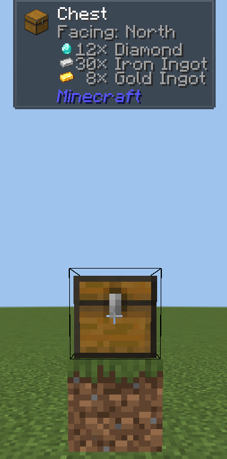

# Jade（統合版への非公式移植）

[English](README.md) | [简体中文](README.zh-CN.md) | [繁體中文](README.zh-TW.md)



見ているブロック・エンティティ・液体の情報（名前・中身・進み具合・体力など）を、画面上部のツールチップに表示します。Snownee 作の Java 版 Mod [Jade](https://github.com/Snownee/Jade) を、Minecraft 統合版向けの [LeviLamina](https://github.com/LiteLDev/LeviLamina) クライアント Mod に移植したものです。

> これは非公式の移植です。Jade の作者 Snownee、Mojang、Microsoft とは関係ありません。この Mod の問題を作者たちに報告しないでください。

## 動作環境

| | 版 |
|---|---|
| Minecraft 統合版 | 1.26.60（Windows） |
| LeviLamina | 26.60.x |

クライアント Mod です。シングルプレイでもサーバーでも動きます（[既知の制限](#既知の制限)を参照）。

## 導入

**lip**

```
lip install github.com/ch1-k-mc/Jade-Bedrock
```

LeviLamina のクライアントのゲームフォルダで実行します。

**手動**: [Releases](../../releases) から `Jade-client-windows-x64.zip` をダウンロードし、`Jade` フォルダを `mods/` に展開します。

## 使い方

| キー | 動作 |
|---|---|
| `テンキー 0` | 設定画面を開く（`/jadec config` でも開く） |
| `テンキー 1` | ツールチップの表示・非表示 |
| `テンキー 2` | 液体の表示・非表示 |
| `左 Shift`（押している間） | 詳しい情報を出す |

キーは設定画面で変えられます。そのほかのコマンド:

| コマンド | 動作 |
|---|---|
| `/jadec get <キー>` / `/jadec set <キー> <値>` | 設定を読む・変える（例: `general.displayMode`、`jade:distance`） |
| `/jadec reload` | 設定ファイルを読み直す |
| `/jadec toggle` | ツールチップの表示・非表示 |
| `/jadec use_profile <0-3>` | 設定のプロファイルを切り替える |
| `/jadec handlers` | 登録されている Provider の一覧を `mods/Jade/jade_handlers.md` に書き出す |

設定ファイルは `mods/Jade/config/jade/`（`jade.json`、プロファイルは `profiles/`）にあります。

## 機能

- ブロック・エンティティ・液体の名前と Mod 名（アドオンはパック名）、アイコン
- 容器の中身、かまど・醸造台の進み具合、大釜の液体、ブロックを壊す進み具合と適正ツール
- 作物、ハチの巣、音符ブロック、レッドストーン、ジュークボックス、書見台、スポナー、コマンドブロック、額縁、棚など
- エンティティの体力と防具、ステータス効果、成長・繁殖の時間、飼い主、村人の職業、ウマの能力、防具立ての装備
- アクセシビリティの詳細（看板の文字、向き、量、姿勢、種類）
- 統合版で足した表示: 大釜の染めた水の色、堆肥箱のたまり具合、リスポーンアンカーのチャージ、アドオンのパック名
- 本家と同じ形の設定画面（検索・プレビュー・テーマ・表示位置・設定のプロファイル）
- 本家のテーマ（Dark・Classic・One Probe・Create と Slim の様式）
- 英語・日本語・中国語（簡体字・繁体字）
- 他の Mod 向けの API: [`include/jade/JadeApi.h`](docs/API.md)（別の DLL からツールチップに行・アイコン・サーバーの値を足せる）

## 既知の制限

- 自分のワールドではないサーバーでは、サーバーだけが持つ情報は出ません（容器の中身、かまどの進み具合、ほかのエンティティのステータス効果、成長の時間など）。名前とブロックの状態は出ます。
- 移植していないもの: ピン留めの画面、読み上げ、レシピビューア（JEI）との連携、電力の表示、デバッグの枠。
- 設定画面の入力欄には英数字と一部の記号だけが入ります。

## ビルド

[xmake](https://xmake.io)、Visual Studio 2022 以降、clang-cl が必要です。

```
xmake f -m release -y
xmake
```

`bin/Jade/` に出力されます。

## ライセンス

本家 Jade と同じ [CC BY-NC-SA 4.0](LICENSE.md) です。営利目的には使えません。本家に含まれる第三者のコード（MIT・Apache-2.0）を含みます。[NOTICE](NOTICE.md) を参照してください。
