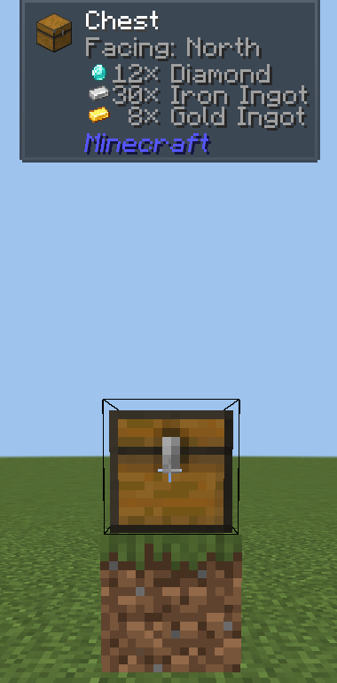

# Jade (unofficial Bedrock port)

[日本語](README.ja.md) | [简体中文](README.zh-CN.md) | [繁體中文](README.zh-TW.md)



Shows information about the block, entity or fluid you are looking at, such as its name, contents, progress and health, in a tooltip at the top of the screen. A [LeviLamina](https://github.com/LiteLDev/LeviLamina) client mod for Minecraft: Bedrock Edition that ports the Java Edition mod [Jade](https://github.com/Snownee/Jade) by Snownee.

> This is an unofficial port, not affiliated with Snownee (the author of Jade) or with Mojang or Microsoft. Please do not report issues with this mod to them.

## Requirements

| | Version |
|---|---|
| Minecraft: Bedrock Edition | 1.26.60 (Windows) |
| LeviLamina | 26.60.x |

Client mod. Works in single player and on servers (see [Known limitations](#known-limitations)).

## Installation

**lip**

```
lip install github.com/ch1-k-mc/Jade-Bedrock
```

Run it in the game directory of your LeviLamina client.

**Manual**: download `Jade-client-windows-x64.zip` from [Releases](../../releases) and extract the `Jade` folder into `mods/`.

## Usage

| Key | Action |
|---|---|
| `Numpad 0` | Open the settings screen (also `/jadec config`) |
| `Numpad 1` | Show / hide the tooltip |
| `Numpad 2` | Show / hide fluids |
| `Left Shift` (hold) | Show more details |

Keys can be changed in the settings screen. Other commands:

| Command | Action |
|---|---|
| `/jadec get <key>` / `/jadec set <key> <value>` | Read or change a setting (for example `general.displayMode`, `jade:distance`) |
| `/jadec reload` | Reload the config files |
| `/jadec toggle` | Show / hide the tooltip |
| `/jadec use_profile <0-3>` | Switch the config profile |
| `/jadec handlers` | Write the list of registered providers to `mods/Jade/jade_handlers.md` |

Config files are in `mods/Jade/config/jade/` (`jade.json`, profiles in `profiles/`).

## Features

- Names and the mod (or add-on pack) of blocks, entities and fluids, with icons
- Container contents, furnace and brewing progress, fluids in cauldrons, block breaking progress and the harvest tool
- Crops, beehives, note blocks, redstone, jukeboxes, lecterns, spawners, command blocks, item frames, shelves and more
- Entity health and armor, status effects, growth and breeding time, owner, villager profession, horse stats, armor stand equipment
- Accessibility details (sign text, facing, amounts, poses, variants)
- Bedrock additions: dyed water color in cauldrons, composter level, respawn anchor charges, add-on pack names
- Settings screen like the original, with search, preview, themes, overlay position and config profiles
- Themes from the original (Dark, Classic, One Probe, Create and Slim styles)
- English, Japanese and Chinese (Simplified / Traditional)
- API for other mods: [`include/jade/JadeApi.h`](docs/API.md) (add lines, icons and server data to the tooltip from another DLL)

## Known limitations

- On a server (not your own world), information that only the server has is not shown: container contents, furnace progress, status effects of other entities, growth time and so on. Names and block states are shown.
- Not ported: the pin screen, text-to-speech, recipe viewer integration (JEI), energy storage, the debug overlay frame.
- Text fields in the settings screen accept only letters, digits and a few symbols.

## Building

Requires [xmake](https://xmake.io), Visual Studio 2022 or later, and clang-cl.

```
xmake f -m release -y
xmake
```

The mod is output to `bin/Jade/`.

## License

[CC BY-NC-SA 4.0](LICENSE.md), the same as the original Jade. Non-commercial use only. Includes code under MIT and Apache-2.0 from the original's third-party sources. See [NOTICE](NOTICE.md).
