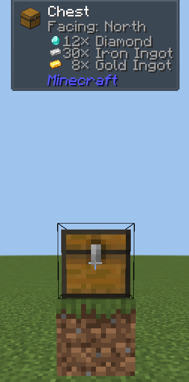

# Jade（基岩版非官方移植）

[English](README.md) | [日本語](README.ja.md) | [繁體中文](README.zh-TW.md)



在屏幕上方的提示框中显示你正在看着的方块、实体或流体的信息，例如名称、内容物、进度和生命值。这是将 Snownee 制作的 Java 版模组 [Jade](https://github.com/Snownee/Jade) 移植到 Minecraft 基岩版 [LeviLamina](https://github.com/LiteLDev/LeviLamina) 客户端的模组。

> 这是非官方移植，与 Jade 的作者 Snownee、Mojang 或 Microsoft 无关。请不要向他们报告本模组的问题。

## 运行环境

| | 版本 |
|---|---|
| Minecraft 基岩版 | 1.26.60（Windows） |
| LeviLamina | 26.60.x |

客户端模组。可用于单人游戏和服务器（参见[已知限制](#已知限制)）。

## 安装

**lip**

```
lip install github.com/ch1-k-mc/Jade-Bedrock
```

在 LeviLamina 客户端的游戏目录中运行。

**手动**：从 [Releases](../../releases) 下载 `Jade-client-windows-x64.zip`，将 `Jade` 文件夹解压到 `mods/`。

## 使用方法

| 按键 | 操作 |
|---|---|
| `小键盘 0` | 打开设置界面（也可用 `/jadec config`） |
| `小键盘 1` | 显示 / 隐藏提示框 |
| `小键盘 2` | 显示 / 隐藏流体 |
| `左 Shift`（按住） | 显示更多详细信息 |

按键可在设置界面中更改。其他命令：

| 命令 | 操作 |
|---|---|
| `/jadec get <键>` / `/jadec set <键> <值>` | 读取或更改设置（例如 `general.displayMode`、`jade:distance`） |
| `/jadec reload` | 重新加载配置文件 |
| `/jadec toggle` | 显示 / 隐藏提示框 |
| `/jadec use_profile <0-3>` | 切换配置方案 |
| `/jadec handlers` | 将已注册的提供器列表写入 `mods/Jade/jade_handlers.md` |

配置文件位于 `mods/Jade/config/jade/`（`jade.json`，配置方案在 `profiles/`）。

## 功能

- 方块、实体和流体的名称及所属模组（附加包则为包名），以及图标
- 容器内容物、熔炉和酿造台的进度、炼药锅中的流体、方块破坏进度和适用工具
- 作物、蜂巢、音符盒、红石、唱片机、讲台、刷怪笼、命令方块、物品展示框、书架等
- 实体的生命值和盔甲、状态效果、成长和繁殖时间、主人、村民职业、马的属性、盔甲架的装备
- 无障碍详细信息（告示牌文字、朝向、数量、姿势、变种）
- 基岩版新增：炼药锅中染色水的颜色、堆肥桶进度、重生锚充能、附加包名称
- 与原版相同的设置界面（搜索、预览、主题、位置、配置方案）
- 原版的主题（Dark、Classic、One Probe、Create 及 Slim 样式）
- 英语、日语和中文（简体 / 繁体）
- 供其他模组使用的 API：[`include/jade/JadeApi.h`](docs/API.md)（可从其他 DLL 向提示框添加行、图标和服务器数据）

## 已知限制

- 在服务器上（非自己的世界），只有服务器才有的信息不会显示：容器内容物、熔炉进度、其他实体的状态效果、成长时间等。名称和方块状态会显示。
- 未移植：固定界面、文字转语音、配方查看器（JEI）联动、能量显示、调试框。
- 设置界面的输入框只能输入字母、数字和少量符号。

## 构建

需要 [xmake](https://xmake.io)、Visual Studio 2022 或更高版本以及 clang-cl。

```
xmake f -m release -y
xmake
```

模组输出到 `bin/Jade/`。

## 许可证

与原版 Jade 相同，采用 [CC BY-NC-SA 4.0](LICENSE.md)。仅限非商业用途。包含原版第三方来源中采用 MIT 和 Apache-2.0 的代码。参见 [NOTICE](NOTICE.md)。
