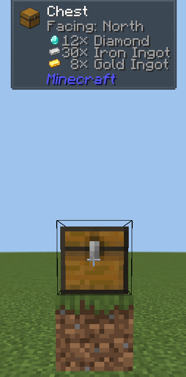

# Jade（基岩版非官方移植）

[English](README.md) | [日本語](README.ja.md) | [简体中文](README.zh-CN.md)



在畫面上方的提示框中顯示你正在看著的方塊、實體或流體的資訊，例如名稱、內容物、進度和生命值。這是將 Snownee 製作的 Java 版模組 [Jade](https://github.com/Snownee/Jade) 移植到 Minecraft 基岩版 [LeviLamina](https://github.com/LiteLDev/LeviLamina) 用戶端的模組。

> 這是非官方移植，與 Jade 的作者 Snownee、Mojang 或 Microsoft 無關。請不要向他們回報本模組的問題。

## 執行環境

| | 版本 |
|---|---|
| Minecraft 基岩版 | 1.26.60（Windows） |
| LeviLamina | 26.60.x |

用戶端模組。可用於單人遊戲和伺服器（參見[已知限制](#已知限制)）。

## 安裝

**lip**

```
lip install github.com/ch1-k-mc/Jade-Bedrock
```

在 LeviLamina 用戶端的遊戲資料夾中執行。

**手動**：從 [Releases](../../releases) 下載 `Jade-client-windows-x64.zip`，將 `Jade` 資料夾解壓縮到 `mods/`。

## 使用方法

| 按鍵 | 操作 |
|---|---|
| `數字鍵盤 0` | 開啟設定畫面（也可用 `/jadec config`） |
| `數字鍵盤 1` | 顯示 / 隱藏提示框 |
| `數字鍵盤 2` | 顯示 / 隱藏流體 |
| `左 Shift`（按住） | 顯示更多詳細資訊 |

按鍵可在設定畫面中變更。其他指令：

| 指令 | 操作 |
|---|---|
| `/jadec get <鍵>` / `/jadec set <鍵> <值>` | 讀取或變更設定（例如 `general.displayMode`、`jade:distance`） |
| `/jadec reload` | 重新載入設定檔 |
| `/jadec toggle` | 顯示 / 隱藏提示框 |
| `/jadec use_profile <0-3>` | 切換設定檔 |
| `/jadec handlers` | 將已註冊的提供器清單寫入 `mods/Jade/jade_handlers.md` |

設定檔位於 `mods/Jade/config/jade/`（`jade.json`，設定檔方案在 `profiles/`）。

## 功能

- 方塊、實體和流體的名稱及所屬模組（附加元件則為包名），以及圖示
- 容器內容物、熔爐和釀造台的進度、鍋釜中的流體、方塊破壞進度和適用工具
- 作物、蜂窩、音階盒、紅石、唱片機、講台、生怪磚、指令方塊、物品展示框、書架等
- 實體的生命值和盔甲、狀態效果、成長和繁殖時間、主人、村民職業、馬的屬性、盔甲座的裝備
- 無障礙詳細資訊（告示牌文字、朝向、數量、姿勢、變種）
- 基岩版新增：鍋釜中染色水的顏色、堆肥桶進度、重生錨充能、附加元件名稱
- 與原版相同的設定畫面（搜尋、預覽、主題、位置、設定檔方案）
- 原版的主題（Dark、Classic、One Probe、Create 及 Slim 樣式）
- 英文、日文和中文（簡體 / 繁體）
- 供其他模組使用的 API：[`include/jade/JadeApi.h`](docs/API.md)（可從其他 DLL 向提示框新增行、圖示和伺服器資料）

## 已知限制

- 在伺服器上（非自己的世界），只有伺服器才有的資訊不會顯示：容器內容物、熔爐進度、其他實體的狀態效果、成長時間等。名稱和方塊狀態會顯示。
- 未移植：釘選畫面、文字轉語音、配方檢視器（JEI）連動、能量顯示、除錯框。
- 設定畫面的輸入框只能輸入字母、數字和少量符號。

## 建置

需要 [xmake](https://xmake.io)、Visual Studio 2022 或更新版本以及 clang-cl。

```
xmake f -m release -y
xmake
```

模組輸出到 `bin/Jade/`。

## 授權

與原版 Jade 相同，採用 [CC BY-NC-SA 4.0](LICENSE.md)。僅限非商業用途。包含原版第三方來源中採用 MIT 和 Apache-2.0 的程式碼。參見 [NOTICE](NOTICE.md)。
